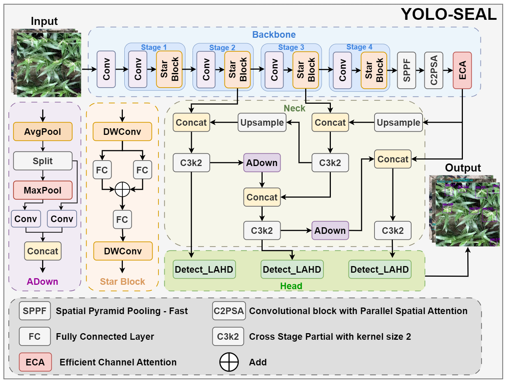
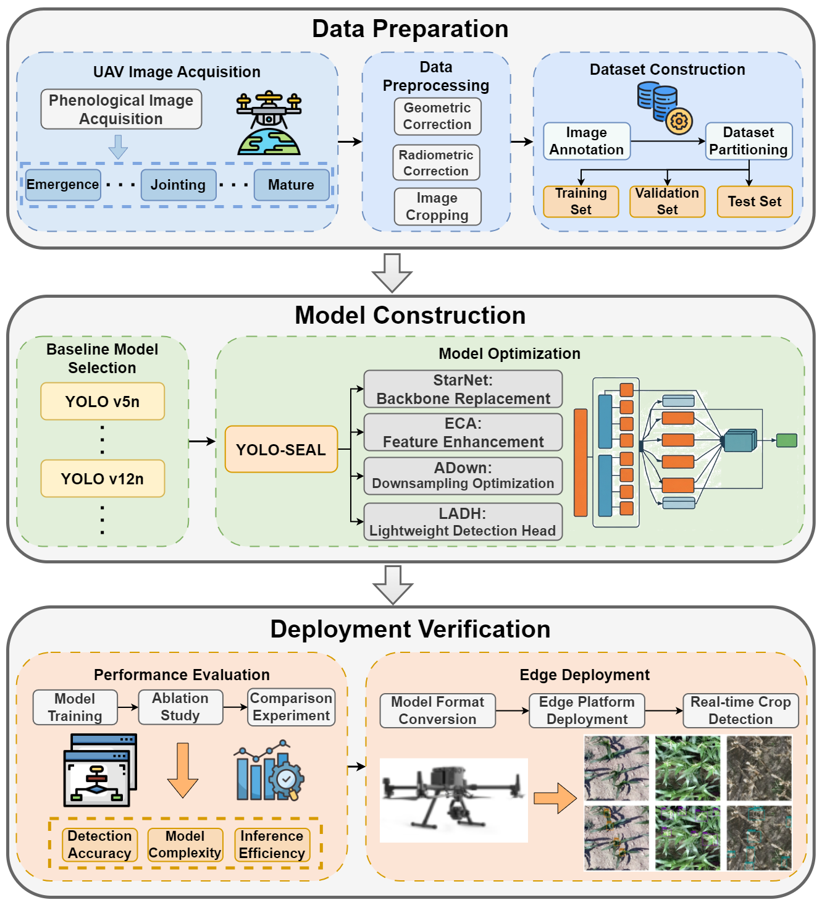
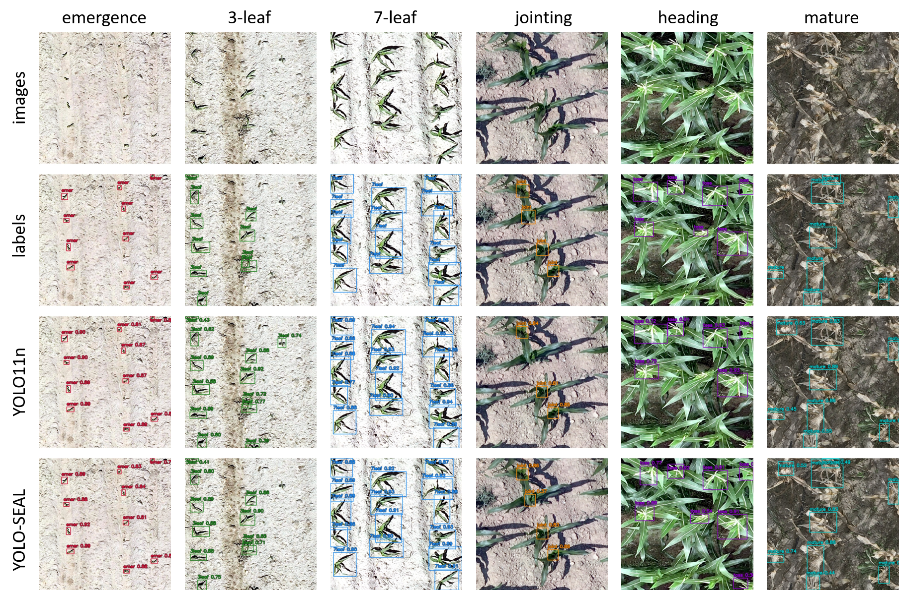
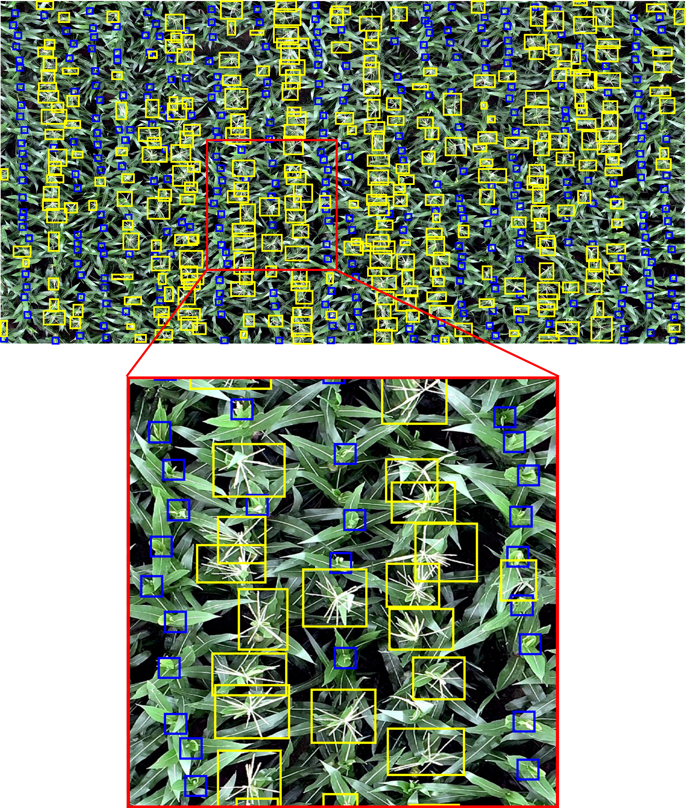
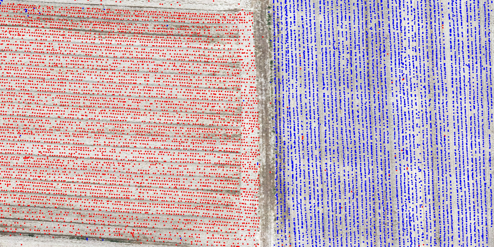

# YOLO-SEAL: Lightweight Crop Phenological Stage Detection in UAV Images

This repository contains the supplied YOLO-SEAL model configurations, a customized Ultralytics codebase, training and testing scripts, model checkpoints, ONNX exports, and project figures. YOLO-SEAL combines **StarNet**, **Efficient Channel Attention (ECA)**, **ADown**, and a **Lightweight Adaptive Detection Head (LADH)** for crop detection across growth stages.

The implementation builds on Ultralytics YOLO11. Training and testing instructions below follow the accompanying command documents.

> **Source completeness:** the supplied `test.py` currently ends after `parse_args()` and has no evaluation entry point. In addition, `ultralytics/nn/tasks.py` imports backbone modules absent from this source package, including `lsnet`, `convnextv2`, and `repvit`. The commands document the intended workflow; complete these source files before attempting to reproduce experiments. See [Known Limitations](#known-limitations).

## Updates

- **2026.10** — Initial public release of the supplied source package, model weights, ONNX models, project figures, and training/testing documentation.
- The large `0519big.png` is provided as a compressed copy; the original image remains in the local source folder.

## Summary

YOLO-SEAL uses a StarNet backbone for feature extraction, ECA for channel feature enhancement, ADown for downsampling, and LADH for detection at multiple feature scales. The supplied model configuration is available at [`ultralytics/cfg/models/starnet/yolo11-starnet-ECA-ADown-LADH.yaml`](ultralytics/cfg/models/starnet/yolo11-starnet-ECA-ADown-LADH.yaml).

The project workflow covers UAV image acquisition, geometric and radiometric correction, image cropping and annotation, dataset partitioning, model evaluation, and deployment preparation.

## Architecture

### YOLO-SEAL model



| Component | Configuration or implementation | Role |
| --- | --- | --- |
| StarNet | `starnet_s050` | Backbone feature extraction |
| ECA | `EfficientChannelAttention` | Channel feature enhancement |
| ADown | `ADown` | Feature downsampling |
| LADH | `Detect_LADH` | Multi-scale detection head |

### Overall workflow



## Experimental Results

The supplied package includes example detection figures and model artifacts, but no numerical benchmark table or experiment summary files. Quantitative comparisons should be added after collecting independently verified results on the documented dataset split.

| Metric | Description |
| --- | --- |
| Precision / Recall | Detection precision and recall |
| F1-score | Harmonic mean of precision and recall |
| mAP50 | Mean average precision at IoU 0.50 |
| mAP75 | Mean average precision at IoU 0.75 |
| mAP50-95 | Mean average precision over IoU 0.50–0.95 |
| Parameters / GFLOPs | Model size and computational complexity |
| Latency / FPS | Inference efficiency under the reported hardware and settings |

## Visualization

### Detection examples across growth stages



### Detailed jointing and tasseling examples



### Large-field image



The README uses a lightweight JPEG preview. Download the [compressed PNG](0519big.png) for a higher-resolution copy.

## Model Download

| Model artifact | PyTorch checkpoint | ONNX export |
| --- | --- | --- |
| YOLO-SEAL | [`seal_best.pt`](weight/seal_best.pt) | [`seal_best.onnx`](weight/seal_best.onnx) |
| YOLO-SEAL FP32 | [`seal_best_fp32.pt`](weight/seal_best_fp32.pt) | [`seal_best_fp32.onnx`](weight/seal_best_fp32.onnx) |
| YOLO11n baseline | [`11n_best.pt`](weight/11n_best.pt) | [`11n_best.onnx`](weight/11n_best.onnx) |

Additional download locations supplied with the project:

- **Dataset:** [Baidu Drive](https://pan.baidu.com/s/19CyQrdtVBxlc68VF_sSDyg?pwd=2025) — extraction code: `2025`.
- **Model weights:** [Baidu Drive](https://pan.baidu.com/s/13g2787bWxeug-FLGqZ-F3Q?pwd=2025) — extraction code: `2025`.

The external links are reproduced from the supplied files; their contents and availability have not been independently verified.

## Quick Start

This guide describes environment setup, dataset preparation, training, and evaluation. Run commands from the repository root after resolving the source completeness issues noted above.

### 1. Installation

#### Clone the repository

```bash
git clone https://github.com/klifaxxw/YOLO-SEAL.git
cd YOLO-SEAL
```

#### Prepare an environment

Use an isolated environment compatible with the supplied dependencies. The original package contains Python 3.8 bytecode caches; those generated caches have been excluded from this release. The dependency snapshot records PyTorch `2.4.1+cu121`, torchvision `0.19.1+cu121`, and Ultralytics `8.3.221`; a clean installation has not been verified.

```bash
conda create -n yolo-seal python=3.8
conda activate yolo-seal
```

Install the recorded PyTorch versions from the CUDA 12.1 wheel index:

```bash
python -m pip install torch==2.4.1 torchvision==0.19.1 torchaudio==2.4.1 --index-url https://download.pytorch.org/whl/cu121
```

[`requirements.txt`](requirements.txt) is the original environment snapshot. It contains platform-specific and optional deployment packages, and its pinned `opencv-python==4.12.0.88` and `numpy==1.24.1` requirements may conflict. Adapt the snapshot to your platform and resolve dependency conflicts before installing it:

```bash
python -m pip install -r requirements.txt
```

Run from the project root to import the customized local `ultralytics/` package. The upstream pip package alone does not include this project's custom model modules. This source package does not include a root `setup.py` or `pyproject.toml` for editable installation.

### 2. Prepare Dataset

Download the dataset from the [provided dataset link](https://pan.baidu.com/s/19CyQrdtVBxlc68VF_sSDyg?pwd=2025), or prepare a YOLO detection dataset with the following example layout:

```text
your_dataset/
├── data.yaml
├── images/
│   ├── train/
│   ├── val/
│   └── test/
└── labels/
    ├── train/
    ├── val/
    └── test/
```

Example `data.yaml` structure:

```yaml
path: /absolute/path/to/your_dataset
train: images/train
val: images/val
test: images/test
names:
  0: your_class_0
  1: your_class_1
```

Replace the example class names and indices with the dataset's actual annotation mapping. Each label row must follow the YOLO detection format `class_id x_center y_center width height`, with coordinates normalized to the image dimensions.

Pass the dataset YAML explicitly with `--data`. Training validates against the validation split; final evaluation should use a separate test split specified in `data.yaml`.

### 3. Training

The supplied `train.py` accepts training parameters, optional initialization weights, and experiment output settings. After training, it evaluates the best checkpoint when available and writes experiment summaries.

#### Train YOLO-SEAL from scratch

```bash
python train.py \
  --model ultralytics/cfg/models/starnet/yolo11-starnet-ECA-ADown-LADH.yaml \
  --data /path/to/your_dataset/data.yaml \
  --epochs 100 \
  --batch 16 \
  --imgsz 640 \
  --device 0 \
  --name YOLO_SEAL
```

#### Train the YOLO11 baseline from scratch

This is the baseline command provided in the training document:

```bash
python train.py \
  --model ultralytics/cfg/models/11/yolo11.yaml \
  --data /path/to/your_dataset/data.yaml \
  --epochs 100 \
  --batch 16 \
  --imgsz 640 \
  --device 0
```

#### Train with pretrained weights

```bash
python train.py \
  --model ultralytics/cfg/models/11/yolo11.yaml \
  --weights /path/to/yolo11n.pt \
  --data /path/to/your_dataset/data.yaml \
  --epochs 100 \
  --batch 16 \
  --imgsz 640 \
  --device 0
```

`--weights` is optional. When using a YAML model without `--weights`, no external checkpoint is loaded. If `--model` itself points to a checkpoint, model initialization uses that checkpoint. Use weights compatible with the selected architecture when fine-tuning YOLO-SEAL.

#### Parameter Explanation

| Argument | Type | Default | Description |
| --- | --- | --- | --- |
| `--model` | string | `ultralytics/cfg/models/11/yolo11.yaml` | Model YAML or checkpoint path |
| `--weights` | string | None | Optional initialization checkpoint |
| `--data` | string | Required | Dataset YAML configuration |
| `--epochs` | int | `100` | Training epochs |
| `--batch` | int | `16` | Training batch size |
| `--imgsz` | int | `640` | Input image size |
| `--workers` | int | `8` | Data-loading workers |
| `--device` | string | `0` | Device, such as GPU `0` or `cpu` |
| `--optimizer` | string | `auto` | Optimizer selection |
| `--cache` | string | `disk` | `false`, `ram`, or `disk` |
| `--project` | string | `runs/detect` | Experiment output root |
| `--name` | string | `train` | Experiment name |
| `--seed` | int | `0` | Random seed |
| `--exist-ok` | flag | Disabled | Reuse an existing experiment directory |

Reduce `--batch` if GPU memory is insufficient. On Windows, `--workers 0` can simplify data-loader troubleshooting. The multiline examples use Bash continuation (`\`); use one line or PowerShell backticks when running in PowerShell.

#### Training Outputs

The default experiment directory is `runs/detect/train/`, or the directory chosen through `--project` and `--name`. Ultralytics may create a numbered directory if the target already exists.

```text
runs/detect/<experiment>/
├── weights/
│   ├── best.pt
│   └── last.pt
├── results_summary.txt
├── results_summary.json
└── ...
```

The summaries record precision, recall, F1-score, mAP50, mAP75, mAP50-95, latency, estimated FPS, runtime, configuration, and environment details. Post-training validation evaluates `weights/best.pt` when available, otherwise the current model.

### 4. Evaluation

The following commands and output descriptions are taken from the testing document. **They require a completed `test.py`; the supplied file currently has no evaluation main function.**

#### Evaluate a trained checkpoint

```bash
python test.py \
  --weights runs/detect/YOLO_SEAL/weights/best.pt \
  --data /path/to/your_dataset/data.yaml \
  --split test \
  --imgsz 640 \
  --batch 1 \
  --device 0 \
  --exp-name YOLO_SEAL
```

#### Evaluate the supplied YOLO-SEAL weights

```bash
python test.py \
  --weights weight/seal_best.pt \
  --data /path/to/your_dataset/data.yaml \
  --split test \
  --imgsz 640 \
  --batch 1 \
  --device 0 \
  --exp-name YOLO_SEAL
```

#### Parameter Explanation

| Argument | Type | Default | Description |
| --- | --- | --- | --- |
| `--weights` | string | None | Explicit checkpoint path; the document describes a fallback under `runs/detect/<exp-name>/weights/best.pt` |
| `--data` | string | `../Full_dataset_2025/data.yaml` | Dataset YAML; pass a valid path explicitly |
| `--exp-name` | string | `YOLO_SEAL` | Experiment name |
| `--split` | string | `test` | `train`, `val`, or `test` |
| `--imgsz` | int | `640` | Input image size |
| `--batch` | int | `1` | Evaluation batch size |
| `--device` | string | `0` | Evaluation device |
| `--workers` | int | `1` | Data-loading workers |
| `--conf` | float | `0.001` | Confidence threshold |
| `--iou` | float | `0.6` | Non-maximum suppression IoU threshold |
| `--max-det` | int | `300` | Maximum detections per image |
| `--project` | string | `runs/test` | Evaluation output root |
| `--half` | flag | Disabled | FP16 inference |
| `--save-json` | flag | Disabled | COCO-format predictions when supported |
| `--no-plots` | flag | Disabled | Disable evaluation plots |

All testing arguments are optional in the parser, but evaluation requires valid checkpoint and dataset files. The documented fallback path and result-writing logic are not implemented in the supplied file.

#### Documented Evaluation Outputs

The testing document specifies outputs under `runs/test/<experiment_name>/`:

| File | Intended contents |
| --- | --- |
| `paper_data.txt` | Model information and per-class evaluation metrics |
| `results_summary.txt` | Human-readable complexity, speed, and metric summary |
| `results_summary.json` | Structured evaluation results |
| Additional artifacts | Ultralytics plots and evaluation outputs |

Record the evaluated split, checkpoint, input size, precision mode, device, and hardware when reporting results. Validation scores, test scores, and FPS measured with different settings should be reported separately.

## Repository Structure

```text
YOLO-SEAL/
├── ultralytics/                   # Customized local Ultralytics code
│   └── cfg/models/starnet/        # YOLO-SEAL and ablation configurations
├── weight/                        # Supplied PyTorch and ONNX artifacts
├── train.py                       # Training and post-training validation
├── test.py                        # Supplied test parser and helpers
├── requirements.txt               # Original dependency snapshot
├── YOLO-SEAL模型架构图.png          # Model architecture
├── 总体框架图.png                  # Project workflow
├── 结果图.png                     # Detection examples
├── 抽穗拔节-细化.png               # Detailed examples
├── 0519big.png                    # Compressed large-field image
├── 0519big-preview.jpg            # README preview
├── dataset链接.txt                # Original dataset download link
├── weight链接.txt                 # Original weight download link
└── README.md
```

## Known Limitations

- The original `test.py` ends at `return parser.parse_args()` and does not call `model.val()`, generate reports, or define a main entry point.
- Static inspection found 18 references to unavailable local modules, originating in `ultralytics/nn/tasks.py`. Several extra modules also depend on missing backbones through relative imports. Python syntax checks alone cannot verify that the package can be imported.
- The dependency file is a frozen environment snapshot with conflicting pins and platform-specific packages. No clean installation, GPU training, or checkpoint evaluation was performed for this release.
- The dataset, authoritative class mapping, numerical benchmark results, and paper citation metadata were not included in the source folder. Use the provided dataset link and verified experiment records to complete them.

The supplied Python source and model artifacts are preserved. Generated bytecode caches are omitted, and only `0519big.png` has been replaced with a compressed copy for upload.

## Citation

Paper title, authors, publication venue, and identifier were not supplied with this release. Citation information can be added when the authoritative publication metadata becomes available.

## Acknowledgement

This project builds on [Ultralytics](https://github.com/ultralytics/ultralytics). Original copyright and license notices in the source and third-party components have been retained. Ultralytics files identify their license as AGPL-3.0; bundled components include their own license files.

README organization follows the supplied [SFMNet reference](https://github.com/klifaxxw/SFMNet).
